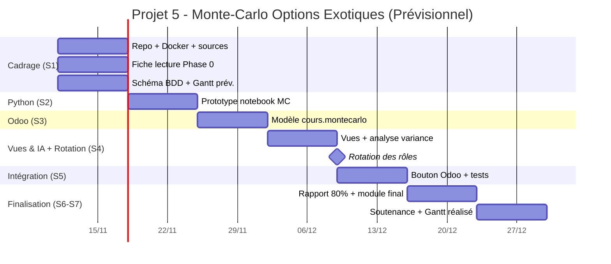

# Gantt prévisionnel — Projet 5 (Semaine 1)

**Projet :** Monte-Carlo pour Options Exotiques (Groupe 5)  
**Membres :** LAHLALI Abdelhaq, KHALLOUK Abderrahmane, MAELAININE Chaibatta, ADIL Youness  
**Rôles S1–S4 (à confirmer par l’équipe) :** Chef de Projet/Finance, Quant/Data (Python), Développeur Odoo (ERP), Ingénieur IA/Testeur. **Rotation des rôles fin S4** (obligatoire).

## Jalons (7 semaines)
| Jalon | Semaine | Attendu |
|---|---|---|
| S1 | Cadrage & Théorie | Repo, Docker, source données, fiche de lecture Phase 0, schéma BDD, **Gantt prévisionnel** |
| S2 | Prototype Python | Formules expliquées, algorithmes MC sur notebook |
| S3 | Modèle Odoo | Champs/modèles créés dans `cours_derives` (`cours.montecarlo`) |
| S4 | Vues & IA (mi-parcours) | Vues Odoo, modèle/variance-réduction entraîné-analysé, **rotation des rôles**, Gantt mis à jour |
| S5 | Intégration | Bouton Odoo déclenche le calcul, tests unitaires passent |
| S6 | Tests & Rédaction | Module finalisé, rapport 80 %, Gantt inclus |
| S7 | Soutenance | Rapport final + Gantt réalisé, code source, démo 15 min |

## Planning prévisionnel (tâches, responsables, dates relatives)
> Ajuster les noms des responsables selon l’attribution réelle des rôles. Durées indicatives sur 7 semaines.

| Phase | Tâche | Responsable (rôle) | Début | Fin | Statut S1 |
|---|---|---|---|---|---|
| Cadrage | Création repo GitHub + structure | Tous / Chef de projet | S1 | S1 | Fait |
| Cadrage | Installation & validation Docker (TP0) | Dév. Odoo | S1 | S1 | À valider équipe |
| Cadrage | Choix source données/paramètres + graine | Quant/Data | S1 | S1 | Fait (doc) |
| Théorie | Fiche de lecture Phase 0 (≤2 p.) | Chef de projet + équipe | S1 | S1 | Fait (doc) |
| Conception | Schéma BDD (`cours.montecarlo`) | Dév. Odoo | S1 | S1 | Fait (doc) |
| Planification | Gantt prévisionnel + rotation S4 | Chef de projet | S1 | S1 | Fait (doc) |
| Qualité | Plan validation/tests & reproductibilité | Ingénieur IA/Testeur | S1 | S1 | Fait (doc) |
| Python | Prototype notebook MC (prix, IC) | Quant/Data | S2 | S2 | Prévu |
| Python | Variable de contrôle + convergence SE(N) | Quant/Data + IA/Testeur | S2 | S4 | Prévu |
| Odoo | Modèle `cours.montecarlo` + champs | Dév. Odoo | S3 | S3 | Prévu |
| Odoo | `action_simuler()` (appel Python) | Dév. Odoo + Quant/Data | S3 | S5 | Prévu |
| Odoo | Vues formulaire/liste + indicateur variance | Dév. Odoo | S4 | S4 | Prévu |
| IA/Test | Analyse réduction variance / courbes | Ingénieur IA/Testeur | S4 | S5 | Prévu |
| Intégration | Intégration bouton Odoo ↔ calcul | Tous | S5 | S5 | Prévu |
| Tests | Tests unitaires (pytest) + non-régression | Ingénieur IA/Testeur | S5 | S6 | Prévu |
| Rédaction | Rapport (80% S6) + Gantt inclus | Chef de projet | S4 | S6 | Prévu |
| Soutenance | Diapos + démo + rapport final + Gantt réalisé | Tous | S7 | S7 | Prévu |

## Rotation des rôles (fin S4)
- **Semaines 1–4 :** Rôles initiaux tels qu’attribués par l’équipe.
- **Fin semaine 4 (jalon) :** permutation des rôles (ex. Développeur Odoo ↔ Quant/Data, Chef de projet ↔ Ingénieur IA/Testeur — à préciser).
- **Semaines 5–7 :** rôles permutés appliqués jusqu’à la soutenance.
- La rotation doit être visible sur le Gantt réalisé (mise à jour à chaque séance).

## Vue Gantt (Mermaid, prévisionnel)

> **Note :** dates à caler sur le calendrier réel des séances. La version **réalisée** sera mise à jour chaque semaine et déposée en `docs/gantt_realise.png` (+ source) dans le livrable final.
