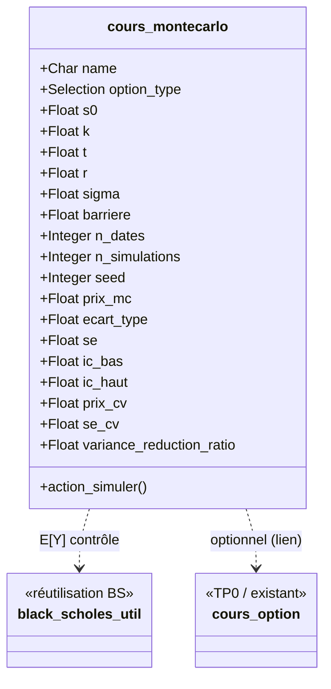

# Schéma de base de données — Semaine 1 (Projet 5)

Extension du module **`cours_derives`** (TP 0) pour le Projet 5 : *Monte-Carlo pour Options Exotiques*.

## 1. Modèle à ajouter : `cours.montecarlo`

| Champ | Type Odoo (proposé) | Description |
|---|---|---|
| `name` | Char | Référence de la simulation |
| `option_type` | Selection | `asian_call`, `asian_put`, `barrier_knockout_call` (extension) |
| `s0` | Float | Prix initial du sous-jacent $S_0$ |
| `k` | Float | Strike $K$ |
| `t` | Float | Maturité $T$ (années) |
| `r` | Float | Taux sans risque $r$ |
| `sigma` | Float | Volatilité $\sigma$ |
| `barriere` | Float | Niveau de barrière $H$ (si type barrière) |
| `n_dates` | Integer | Nombre de dates de fixing $n$ (ex. 252) |
| `n_simulations` | Integer | Nombre de simulations $N$ |
| `seed` | Integer | Graine RNG (reproductibilité, ex. 42) |
| `prix_mc` | Float (readonly) | Prix Monte-Carlo $\hat{P}_N$ |
| `ecart_type` | Float (readonly) | Écart-type empirique des payoffs actualisés $s$ |
| `se` | Float (readonly) | Erreur standard $SE = s/\sqrt{N}$ |
| `ic_bas` | Float (readonly) | Borne basse IC 95 % |
| `ic_haut` | Float (readonly) | Borne haute IC 95 % |
| `prix_cv` | Float (readonly) | Prix avec variable de contrôle |
| `ecart_type_cv` / `se_cv` | Float (readonly) | Dispersion/SE après contrôle |
| `variance_reduction_ratio` | Float (readonly, compute) | Indicateur $SE/SE_{cv}$ (ou rapport des variances) |
| `currency_id` / `company_id` | Many2one (optionnel) | Conventions d’affichage si requis |

**Méthode :** `action_simuler()` — exécute la simulation (NumPy), remplit les champs résultats (MC + IC + contrôle de variance).

## 2. Réutilisation / liens avec `cours_derives` existant
- **Réutilisation Black-Scholes (TP 0 / Groupe 1 si disponible)** : fonction/pricing BS pour obtenir $E[Y]$ (call européen de contrôle, même $S_0,K,T,r,\sigma$) et pour comparaison.
- **Extension possible de `cours.option`** (`_inherit`) : non obligatoire pour le cœur MC, mais peut servir à lier une simulation à une option existante (champ `option_id = Many2one('cours.option')`) — à décider en S2/S3.
- **Pas de nouvelle relation complexe requise en S1** : modèle autonome suffisant pour le cadrage.

## 3. Vues prévues (S3)
- **Form view** : saisie des paramètres + bouton `action_simuler` + groupes de résultats (MC / IC / contrôle de variance) + indicateur de réduction de variance.
- **Tree view** : liste des simulations (type, $S_0,K,T$, $N$, `prix_mc`, IC, `prix_cv`).
- **(Option)** Graphique/indicateur de convergence ou rapport $SE$ avant/après dans la fiche ou un widget.

## 4. Diagramme (logique)

## 5. Fichiers à produire ensuite
- S3 : `models/cours_montecarlo.py`, `views/cours_montecarlo_views.xml`, mise à jour `__manifest__.py` / security.
- Ce document sert de **schéma BDD S1** (`docs/schema_bdd.md`) à déposer avec le Gantt.
